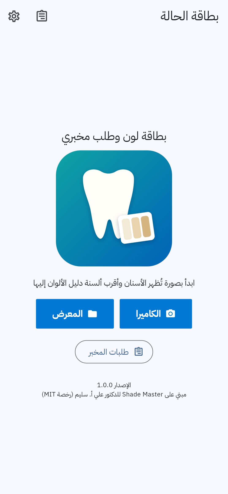
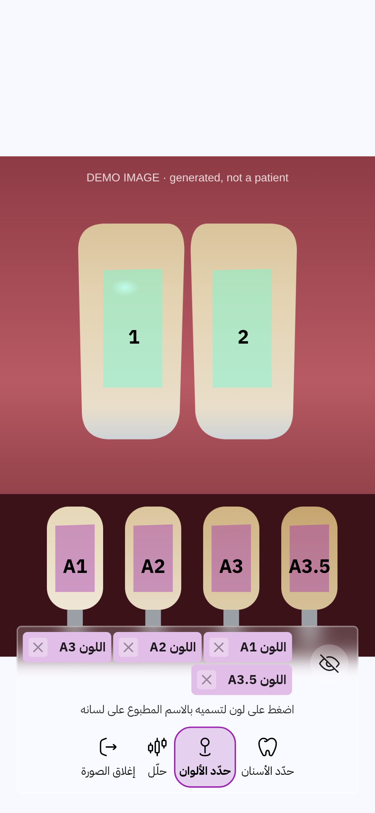
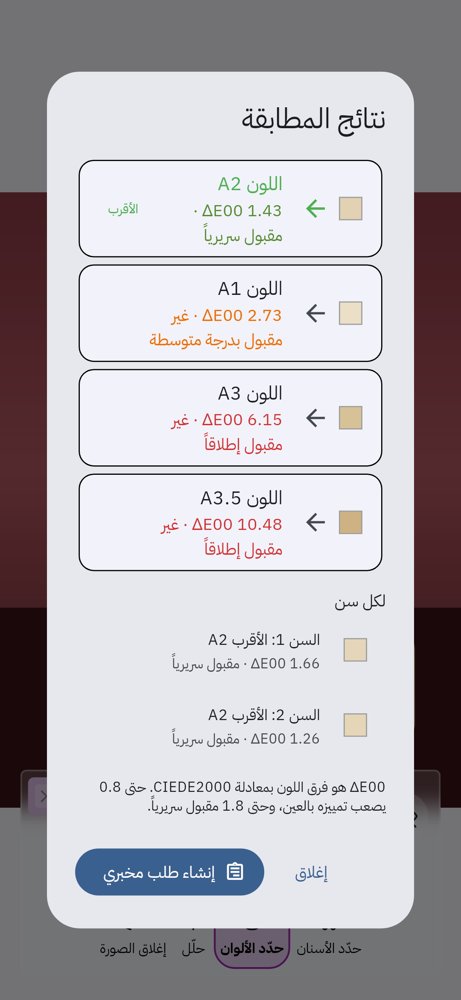
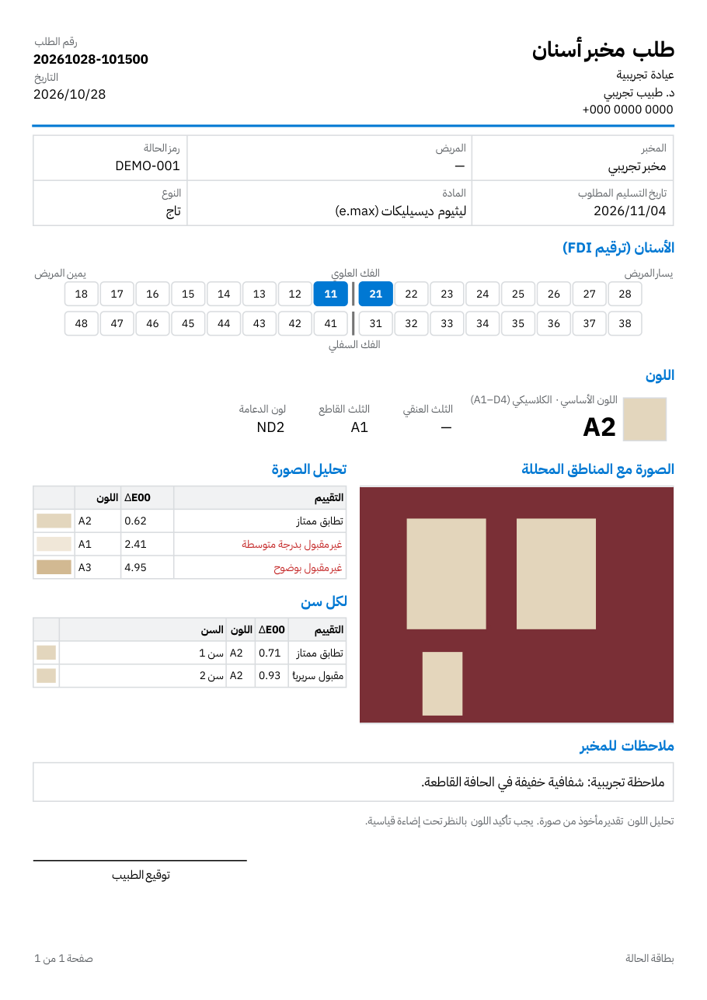

# Dental Case · بطاقة الحالة

**بطاقة لون وطلب مخبري لطبيب الأسنان.** يلتقط الطبيب صورة للأسنان مع ألسنة دليل الألوان، يحدد المناطق بإصبعه، فيحسب التطبيق أقرب لون بمعادلة `CIEDE2000`، ثم يملأ بطاقة طلب للمخبر ويصدّرها ملف `PDF` جاهزاً للمشاركة أو الطباعة. الواجهة بالعربية افتراضياً مع الإنجليزية.

مبني على مشروع [Shade Master](https://github.com/alselawi/shade-master) للدكتور علي أ. سليم (رخصة `MIT`).

| الشاشة الرئيسية | تحديد المناطق | النتائج | بطاقة الطلب |
| --- | --- | --- | --- |
|  |  |  |  |

كل الصور مأخوذة من صورة تجريبية مولّدة (`docs/images/demo-photo.jpg`) وليست لمريض حقيقي.

## طريقة الاستخدام

1. صوّر الأسنان مع ألسنة الدليل الأقرب إليها في لقطة واحدة وتحت الإضاءة نفسها، وتجنّب الانعكاسات قدر الإمكان.
2. اضغط **حدّد الأسنان** وارسم بإصبعك منطقة على كل سن. الخطوط المتلامسة تندمج في منطقة واحدة.
3. اضغط **حدّد الألوان** وارسم منطقة على كل لسان من ألسنة الدليل، ثم اضغط على اسم كل لون في الأسفل لتسميه بالاسم المطبوع على لسانه، مثل `A2`.
4. اضغط **حلّل**. تظهر الألوان مرتبة من الأقرب، مع الفرق `ΔE00` وتقييمه:
   - حتى 0.8: تطابق ممتاز.
   - حتى 1.8: مقبول سريرياً.
   - أكثر من ذلك: غير مقبول بدرجات.
5. اضغط **إنشاء طلب مخبري**. يُملأ اللون الأساسي ونتيجة التحليل تلقائياً. أكمل رمز الحالة والأسنان بترقيم `FDI` ونوع التعويض والمادة، ثم احفظ.
6. تفتح معاينة `PDF` مع أزرار المشاركة والطباعة. الطلبات المحفوظة موجودة في **طلبات المخبر** للتعديل أو الحذف.
7. من **الإعدادات** غيّر اللغة، واحفظ اسم الطبيب والعيادة والمخبر ودليل الألوان لتُملأ في كل طلب جديد.

التحليل تقدير من صورة، ويجب تأكيد اللون بالنظر تحت إضاءة قياسية.

## الخصوصية

لا يرسل التطبيق أي بيانات. الصور والطلبات تبقى على الجهاز، ويُستخدم رمز الحالة بدل اسم المريض افتراضياً. التفاصيل في `docs/privacy-policy.md`.

## البناء

1. `Flutter 3.47.8` و `JDK 17` أو أحدث، و `Android SDK`. إصدارات `SDK` و `NDK` تأتي من `Flutter`.
2. الأوامر:

```bash
flutter pub get
flutter analyze
flutter test
flutter build apk --release
```

3. سير العمل `.github/workflows/android-build.yml` يشغّل التحليل والاختبارات ويبني `APK` و `AAB` عند كل دفع، ويرفعهما في قسم `Artifacts` من صفحة التشغيل.
4. التوقيع والنشر على `Google Play` في `docs/release.md`.

## التوثيق

| الملف | المحتوى |
| --- | --- |
| `docs/how-it-works.md` | الشاشات وخوارزمية مقارنة الألوان والأخطاء التي أُصلحت |
| `docs/roadmap.md` | ما نُفّذ من الخطة وما بقي |
| `docs/prep-report.md` | تقرير الفحص الأول: الترخيص والبناء والتوافق |
| `docs/release.md` | التوقيع والإصدار والنشر |
| `docs/privacy-policy.md` | سياسة الخصوصية بالعربية والإنجليزية |

## الترخيص

`MIT`، انظر `LICENSE`. الخط `IBM Plex Sans Arabic` وجزء `Noto Sans` المضمَّنان بترخيص `SIL OFL 1.1` (في `assets/fonts`). تراخيص الحزم كلها تظهر داخل التطبيق في **الإعدادات** ثم **تراخيص البرمجيات المفتوحة**.

---

## English

Dental Case is a tooth shade card and dental lab order app, built on [Shade Master](https://github.com/alselawi/shade-master) by Dr. Ali A. Saleem. Take one photo with the teeth and shade guide tabs, outline them, and the app ranks the tabs by CIEDE2000 difference against the teeth (the comparison is made inside the same photo and light). The result fills a lab order (FDI teeth, restoration, material, shades, notes, due date) exported as a one page A4 PDF. Arabic (right to left) by default, English available. Everything stays on the device. MIT licensed.
